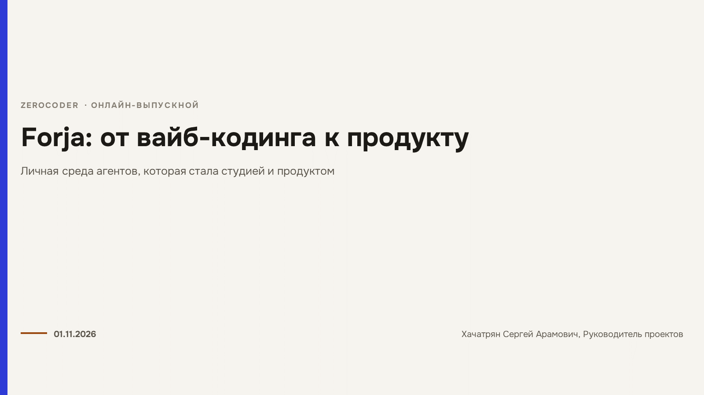
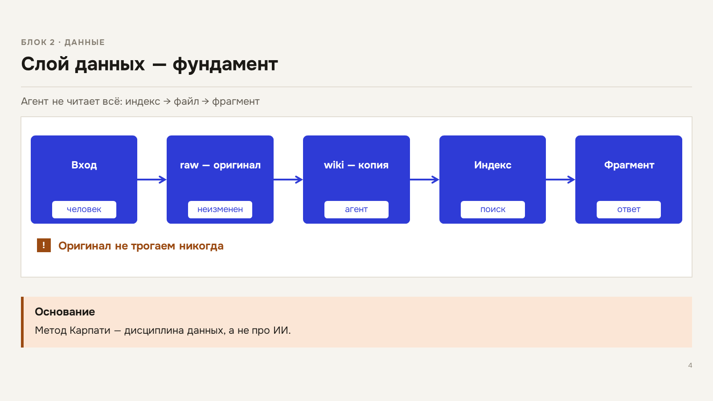
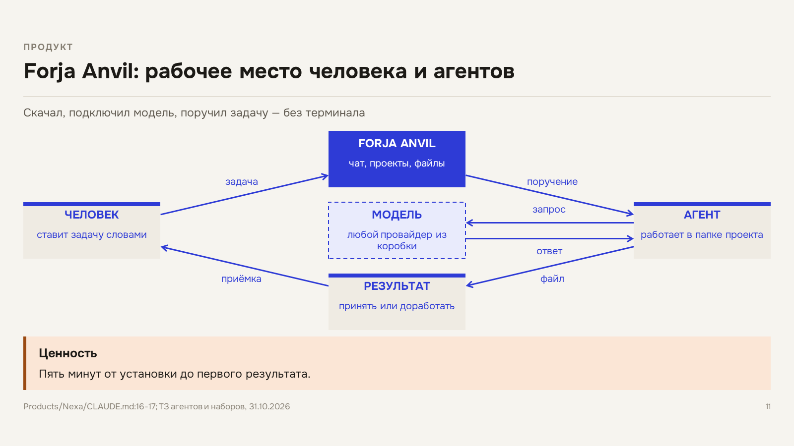
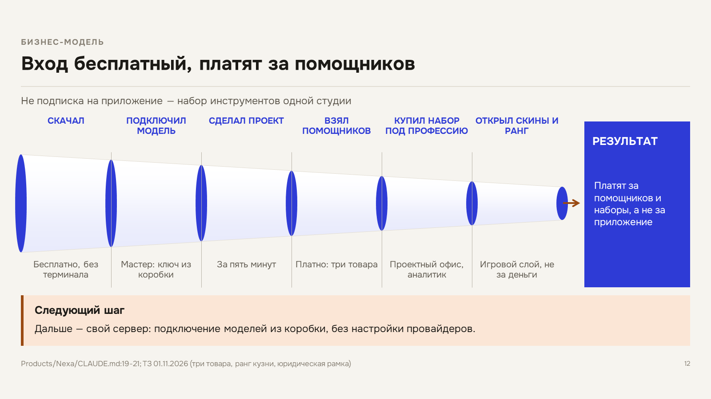

# Forja: от вайб-кодинга к продукту

Выпускной проект курса **ZeroCoder**, 01.11.2026. Доклад на 14 слайдов: как личная среда агентов выросла в студию, а студия — в продукт с идеей развития.

В репозитории лежит не только презентация, но и её исходник: скрипт сборки, фирменный стиль Forja и скилл, который собирает такой доклад по описанию.



## Что внутри

| Путь | Что это |
|---|---|
| `docs/*.pptx` | готовый доклад, 14 слайдов |
| `docs/*.md` | текст доклада: заголовки, тезисы, заметки докладчика |
| `build/build_forja_deck.py` | скрипт сборки: рисует схемы и собирает файл одной командой |
| `style/forja.json` | стиль Forja для библиотеки стилей stylekit: палитра и шрифт из дизайн-системы продукта |
| `skill/SKILL.md` | скилл проекта: как собрать доклад в стиле Forja |
| `deck/*.json` | описание первой версии — только раскладки; сохранено как пример простого пути |
| `screenshots/` | все 14 слайдов в PNG |

## Как это устроено

Доклад собран не раскладками, а схемами: ярусная модель среды, цепочка этапов, было/стало, хаб со спицами, схема взаимодействия человека и агента, воронка бизнес-модели. Схемы, стрелки и карточки рисуются кодом поверх токенов стиля — поэтому цвета и шрифт меняются вместе со стилем, а не правятся вручную на каждом слайде.

Две вещи, которые стоит знать, если будете повторять:

- **Картинок нет.** Сборщик считает любую картинку ошибкой: весь визуал — нативные фигуры PowerPoint. Скриншот интерфейса заменяется моком из фигур или схемой.
- **Раскладок в сборщике семь** (`cards`, `table`, `text`, `kpi`, `chart`, `steps`, `section`). Всё, что сложнее, — схема: её рисует скрипт. Отсюда и структура репозитория.

## Как собрать доклад самому

Нужен [AgentKit](https://github.com/khsergey-afk/agentkit) — плагин документов со встроенным stylekit.

```bash
# 1. положить стиль в библиотеку
cp style/forja.json <agentkit>/src/agentkit/stylekit/data/стили/

# 2. собрать доклад скриптом (текущая версия, схемы)
python build/build_forja_deck.py

# 3. проверить вёрстку
python <agentkit>/src/agentkit/skills/pptx/scripts/pp.py check доклад.pptx
```

В начале скрипта прописаны пути к рабочей папке автора — замените на свои. Простой вариант, без схем, собирается из описания:

```bash
python <agentkit>/src/agentkit/skills/pptx/scripts/pp.py build deck/2026-11-01_forja-выпускной_описание.json \
  --out доклад.pptx --style forja --png tmp/png
```

Скрипт сам ставит сноски с источниками, пишет заметки докладчика и проверяет переполнение текста.

## Слайды

| # | Слайд | Что говорит |
|---|---|---|
| 1 | Титул | Путь: скрипт → среда → студия → продукт |
| 2 | Проблема | Работа держится на руках; ИИ без знаний проекта бесполезен |
| 3 | Блок 1 | Две недели вайб-кодинга: скрипт, сайт, бот, агент |
| 4 | Блок 2 | Слой данных: оригинал → raw → wiki → индекс → фрагмент |
| 5 | Блок 2 | Модель — сменная деталь: среда переехала на свой шлюз за день |
| 6 | Блок 3 | Рутину забрали специализированные агенты: было → стало |
| 7 | Блок 4 | Своя CRM: CoreDesk → Forja |
| 8 | Блок 5 | Что уже работает: сайты, боты, доска, сервер |
| 9 | Демонстрация | Что показываю вживую |
| 10 | Блок 6 | Пазл сложился: Forja AI Studio |
| 11 | Продукт | Forja Anvil: человек, приложение, агент, модель |
| 12 | Бизнес-модель | Вход бесплатный, платят за помощников и наборы |
| 13 | Итоги | Сделано за курс и планы по месяцам |
| 14 | Финал | Спасибо за внимание |




## Что было сделано за курс

- Первый скрипт вместо ручной выгрузки Excel, первый лендинг, первый Telegram-бот.
- Слой данных на методе Карпати: оригинал не трогаем, работаем с копией по индексу.
- Специализированные агенты: описание в JSON и markdown вместо кода.
- Своё приложение: задачи, клиенты, агент рядом с задачей.
- Продукты, которые работают: сайты, автопостинг, бот записи, тренажёр PMP, доска проектов.

## Стиль

Палитра и шрифт взяты из дизайн-системы Forja (`ds-tokens.css`), а не придуманы: тёплая песочная база `#F6F4EF`, графит `#1C1A16`, акцент `#2E3BD6`, огненные подложки, шрифт Onest.



## Автор

Хачатрян Сергей Арамович — руководитель проектов и главный бизнес-архитектор, Санкт-Петербург.
